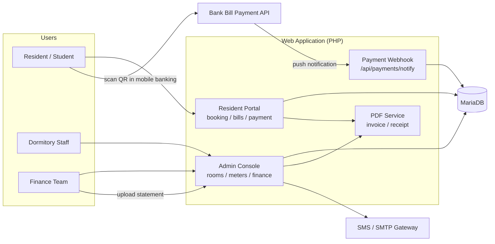
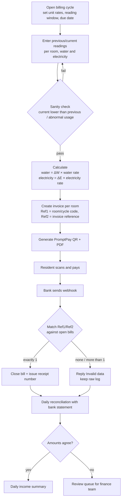
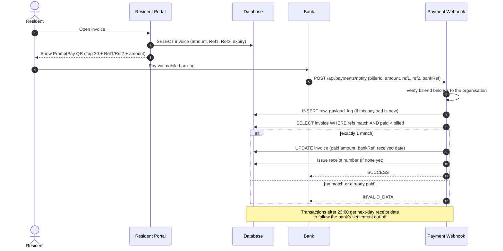
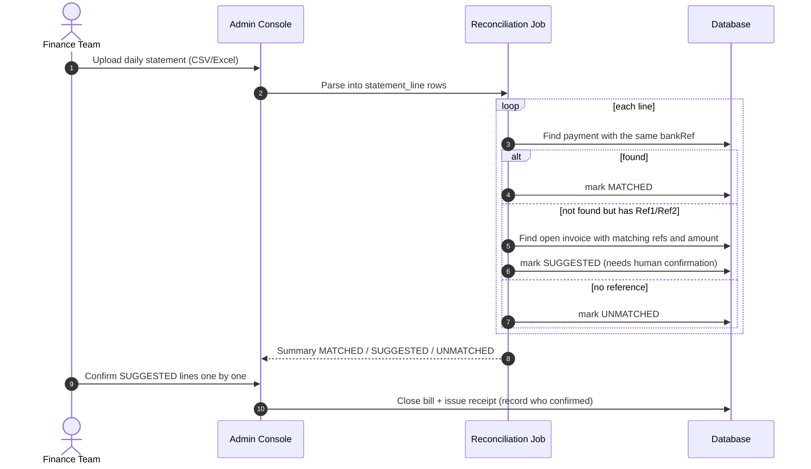
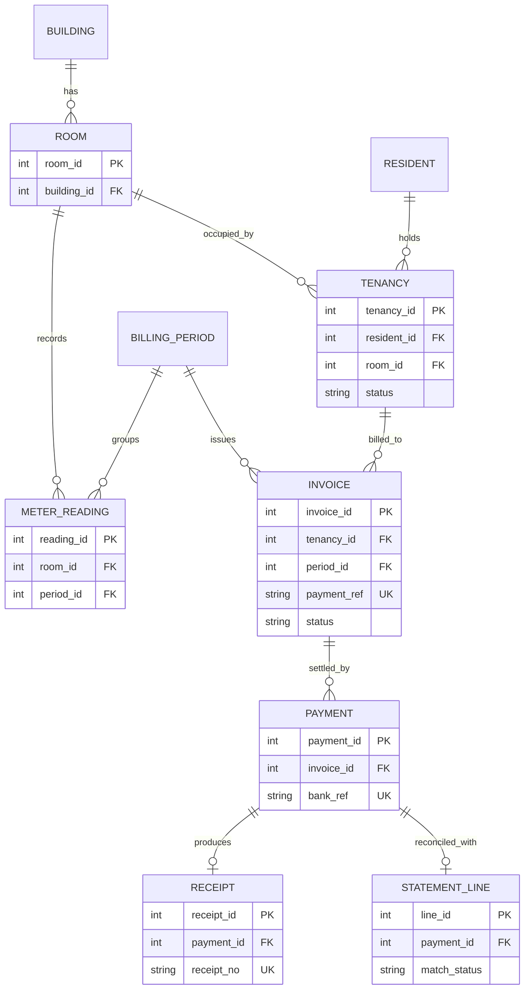

[ไทย](README.md) | [English](README.en.md)

# Dormitory & Residence Management System Architecture

> **Portfolio & NDA Notice:** This repository contains generalized system architecture, workflow diagrams, and sanitized API/data specifications created strictly for technical portfolio purposes. All proprietary source code, production endpoints, credentials, and client/institution identifiers have been omitted or replaced with generic mock data in strict compliance with Non-Disclosure Agreements (NDA).

System analysis and architecture notes for an online student dormitory management system.

**Tech Stack**

| Layer | Technology |
|---|---|
| Backend | Native PHP (no framework), JSON AJAX endpoints |
| Database | MariaDB 10.x (InnoDB) |
| Frontend | Bootstrap 5 (admin theme), jQuery, DataTables |
| Documents | Server-side PDF generation for invoices and receipts |
| Payments | Thai QR Payment (EMVCo, Bill Payment Tag 30) + bank Bill Payment push notification (webhook) |
| Notifications | SMS gateway (OTP / alerts), SMTP |
| Hosting | Linux + Nginx/Apache on a hosting control panel |

---

## Role: Systems Analyst & Technical Consultant

- Ongoing system maintenance (preventive & corrective)
- Gather requirements from dormitory staff and the finance team to design new features
- Design the database (ERD) and the calculation flow for rent and water/electricity bills, including payment reconciliation
- Tune queries and database indexes, and keep sessions stable during term start/end when many users are online at once
- Test the system and verify money amounts before go-live (SIT / UAT)

---

## 1. Problem & Solution

The system serves a multi-building student dormitory with several hundred rooms and a few thousand residents per term. Money flows fall into three groups: per-term dormitory fees, per-cycle water/electricity bills, and fines/other charges.

**Original problems**

1. **Utility bills calculated by hand.** Staff wrote meter readings on paper and calculated in a spreadsheet. Shared rooms had to be split manually. Errors were common and hard to trace.
2. **Checking thousands of transfer slips.** Around due dates, thousands of slips came in. Matching slips to names one by one was slow, and identical amounts (e.g. the same room rate across a whole floor) led to payments matched to the wrong person.
3. **Receipt numbering.** Manually issued receipt numbers were duplicated or skipped, and receipt dates did not line up with the bank's settlement date.

**Approach**

| Problem | Solution |
|---|---|
| Manual billing | A per-room meter entry screen (previous/current) for each billing cycle. The system calculates `units × rate` from the rates set for that cycle and issues invoices for a whole floor in one go. |
| Slip checking | Every invoice carries a **PromptPay Bill Payment QR** with its own Ref1/Ref2. When paid, the bank calls a webhook and the system matches by reference, never by amount. |
| Missed webhooks | Daily reconciliation against the bank statement to find money that arrived but whose bill is still open. |
| Receipt numbers | Automatic e-receipt numbers in the form `fiscal year + sequence`, with a cut-off aligned to the bank's daily settlement. |

---

## 2. System Architecture & Data Flow

### 2.1 System overview



### 2.2 Utility flow: meter reading → invoice → payment → reconciliation



After the due date the system adds a fine to the same bill and **generates a new Ref2** (the old QR can no longer be used because the amount changed). The original reference pair is kept so that payments made with the old QR can still be matched.

### 2.3 Payment webhook sequence



### 2.4 Bank statement reconciliation sequence

This covers money that reached the account but whose webhook never arrived or failed (for example, server timeouts under heavy load). On site these had to be recovered one by one from statements, so the process was designed as a standard procedure.



Key rule: **the system never closes a bill on amount alone.** Lines without a reference always need a human to confirm.

---

## 3. Key Entities (Simplified ERD)

The legacy system stores the invoice and the receipt in the same row, and stores meter readings as one column per cycle (a new column every month). The ERD below is a normalised conceptual model. It shows only the key entities and the keys that link them; it is not the real schema.



| Entity | Role | Design rule |
|---|---|---|
| `TENANCY` | A resident's stay in a term | One table with a status (`BOOKED → CONFIRMED → CHECKED_IN → CHECKED_OUT`) instead of one table per status |
| `METER_READING` | Meter reading per room per cycle | One row per room per cycle instead of a new column every month. The start value must equal the previous cycle's end value. |
| `INVOICE` | Bill (dormitory fee / utilities / fines) | `payment_ref` is the reference embedded in the QR and is what payments are matched on, never the amount |
| `PAYMENT` | Money actually received | Split from the invoice to allow instalments. Unique `bank_ref` blocks duplicates. |
| `RECEIPT` | Electronic receipt | Unique receipt number taken from a counter locked inside a transaction |
| `STATEMENT_LINE` | Line from the bank statement | Holds the reconciliation result `MATCHED / SUGGESTED / UNMATCHED` |

In production, indexes were added on the columns used for reference matching and for lookups by resident, room and bill type. The bill table holds tens of thousands of rows and is queried on every webhook; before the indexes, each match was a full table scan.

---

## 4. Core Endpoints & Sample Data (Dummy Data)

> Endpoint names are generic names used to describe the architecture, not the system's real routes. All samples are dummy data.

### 4.1 Core endpoints

| Method | Endpoint | Caller | Purpose |
|---|---|---|---|
| `POST` | `/api/auth/login` | Resident / staff | Authenticate, issue a server-side session |
| `POST` | `/api/bookings` | Resident | Book a bed during the booking window (check and insert in one transaction) |
| `POST` | `/api/billing-periods/{id}/readings` | Staff | Record meter readings for a billing cycle |
| `POST` | `/api/billing-periods/{id}/invoices` | Staff | Calculate and issue invoices with QR codes for the cycle |
| `POST` | `/api/payments/notify` | Bank | Payment result webhook |
| `POST` | `/api/reconciliations` | Finance | Upload a statement and run reconciliation |

### 4.2 Utility invoice

```json
{
  "invoice_id": 10421,
  "type": "UTILITY",
  "period": "2026-03-R1",
  "room": "B01-0412",
  "water":    { "unit": 18,  "rate": 18.00, "amount": 324.00 },
  "electric": { "unit": 170, "rate": 5.45,  "amount": 926.50 },
  "total": 1250.50,
  "payment_ref": ["2569010412", "1503261430"],
  "due_date": "2026-03-25",
  "status": "UNPAID"
}
```

### 4.3 PromptPay QR (Bill Payment, EMVCo Tag 30)

```
000201 010212
30 67
   00 16 A000000677010112        ← Bill Payment AID
   01 15 010550000000099         ← Biller ID (dummy)
   02 10 2569010412              ← Ref1
   03 10 1503261430              ← Ref2
5303764                          ← THB
54071250.50                      ← amount
5802TH
63043BD8                         ← CRC16-CCITT
```

The QR is dynamic (`010212`) with the amount embedded, so the payer cannot change it. This cuts down under- and over-payments.

### 4.4 Payment webhook

```http
POST /api/payments/notify
{
  "billerId": "010550000000099",
  "amount": "1250.50",
  "reference1": "2569010412",
  "reference2": "1503261430",
  "bankRef": "TXN20260315000001",
  "paidAt": "2026-03-15T14:32:05+07:00"
}
```

| Result | Condition |
|---|---|
| `SUCCESS` | **Exactly one** open invoice matches the references and was updated |
| `INVALID_DATA` | No match, more than one match, or already paid (also stops double posting on bank retries) |
| `UNKNOWN_BILLER` | Biller ID does not belong to the organisation |

Matching tries the current reference pair first, then the original pair (issued before a fine was added), so payments made with an old QR still match.

### 4.5 Statement reconciliation example

| Amount | Reference | Result | Reason |
|---:|---|---|---|
| 1,250.50 | yes | `MATCHED` | Payment with the same bank_ref exists (webhook arrived normally) |
| 3,500.00 | yes | `SUGGESTED` | No payment, but reference and amount match an open bill → webhook was lost, needs confirmation |
| 3,500.00 | no | `UNMATCHED` | Direct transfer; dozens of open bills with the same amount → never auto-match |
| 980.00 | yes | `UNMATCHED` | Reference matches but amount differs (fine already added) → finance review |

---

## 5. Lessons Learned & Security

### 5.1 Duplicate transfers and identical amounts

- **Do not match by amount.** The same room rate across a floor means hundreds of identical amounts. Match by reference only; use the amount as a cross-check, not as the key.
- **Webhooks get retried** (the bank resends when it gets no reply). Three layers stop double posting: unique raw payload log, a `paid < billed` condition in the UPDATE, and a unique `bank_ref` on the payment table.
- **The amount changes after the QR is issued** (fines). Old refs no longer match, and these payments used to get stuck and be closed by hand. Keeping the original refs and matching against them fixed that.
- **Never use `MAX()+1` for receipt numbers.** Two webhooks arriving together get the same number. Use a sequence table with `SELECT … FOR UPDATE` inside a transaction.
- **Bank cut-off.** The bank counts transactions after 23:00 as the next day. Receipt dates must follow that, or daily income will not agree with the statement.

### 5.2 Load on due dates and booking-open days

- On booking-open day thousands of users arrive within minutes. The visible symptom was `504 Gateway Time-out`. Main causes: queries without indexes, and finance report pages that pulled a whole term of data and summed it in PHP.
- Fixes: indexes on the columns used in WHERE/JOIN, limiting data to the current term, enabling the slow query log before booking opens to find queries worth tuning, and aligning PHP-FPM/Nginx timeouts.
- Bed booking must prevent double booking: check bed status and insert inside one transaction (or a unique bed + term constraint), not a check followed by a separate INSERT.
- The webhook must reply fast. Heavy work (PDF generation, SMS) belongs in a queue; otherwise the bank times out and retries, which adds more load.

### 5.3 Access control for personal and financial data

- **SQL injection:** every value from users, cookies or webhooks goes through prepared statements, rolled out starting with the highest-risk entry points: login, session handling and the public payment webhook.
- **Sessions:** never store username/password in cookies. Use a server-side session ID with `HttpOnly`, `Secure`, `SameSite`, and regenerate the ID after login.
- **Passwords:** stored with `password_hash()` (bcrypt/argon2), with automatic rehash on login when an old hash format is found.
- **IDOR:** residents can only see their own bills and receipts. Every endpoint checks ownership instead of trusting IDs sent by the client.
- **Webhook:** verify `billerId`, restrict source IPs to the bank, and log every raw payload for later audit.
- **Secrets:** DB passwords, API keys and SMTP credentials move out of the code into a config file outside the web root and outside Git, and are rotated periodically.
- **Separate DB users:** the application user has no DROP/CREATE rights; backup/restore uses a different user so a restore cannot overwrite production by accident.
- **Upload folders:** script execution disabled, MIME types checked.
- **No data-fix scripts in the web root:** data fixes follow `spec → dry-run → sign-off → generate SQL file for the server admin to run`, and every WHERE clause names the primary key and the term.
- **Test data:** development and testing use a database with personal data masked, and real SMS/email sending is disabled in local/staging.

### 5.4 Pre-release testing (SIT / UAT)

- Compare system-calculated bills with the finance team's spreadsheet for the same cycle, room by room; the difference must be 0.
- Simulate every webhook case: normal, retry, old refs, wrong amount, wrong biller ID, after 23:00.
- Fire concurrent webhooks and confirm receipt numbers have no duplicates or gaps.
- UAT with staff following the real cycle: open cycle → read meters → issue bills → receive payments → close the day.
