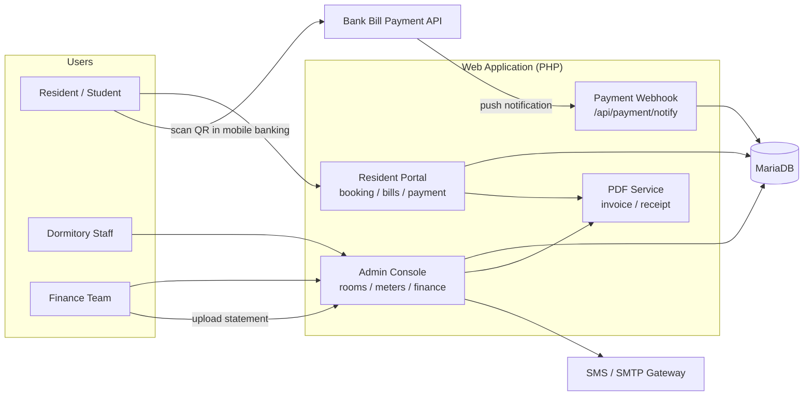
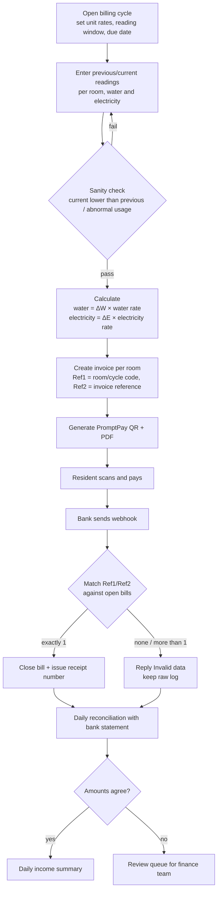
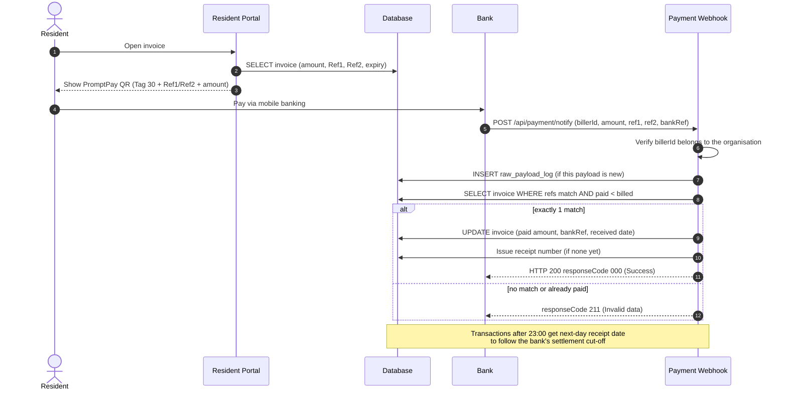
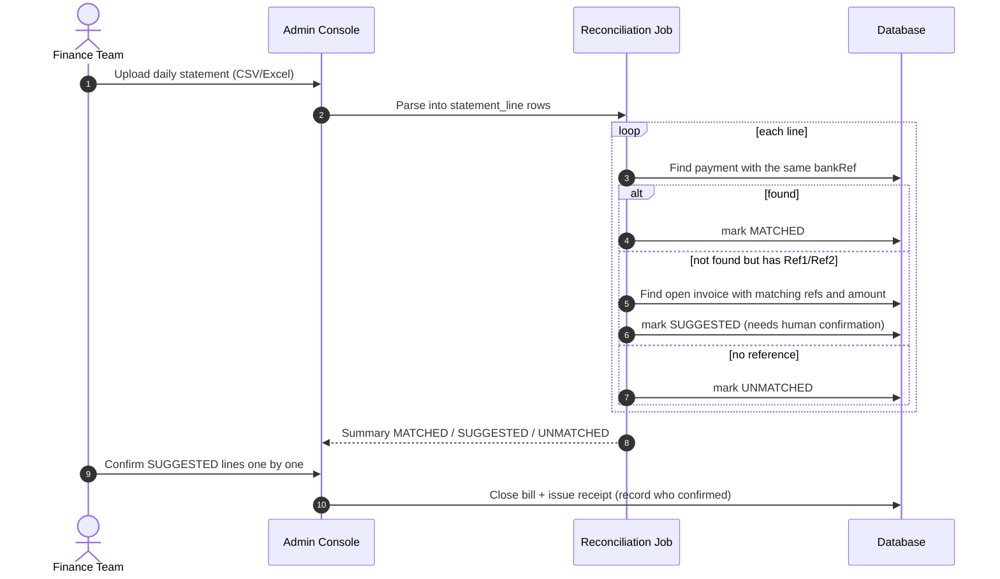

[ไทย](README.md) | [English](README.en.md)

# Dormitory & Residence Management System Architecture

System analysis and architecture notes for an online student dormitory management system (public edition). All table names, variables, endpoints and sample data in this document have been renamed to generic names and replaced with dummy values. Nothing here is the client's real data or configuration.

**Tech Stack**

| Layer | Technology |
|---|---|
| Backend | Native PHP (no framework), JSON AJAX endpoints |
| Database | MariaDB 10.x (InnoDB) |
| Frontend | Bootstrap 5 (admin theme), jQuery, DataTables |
| Documents | Server-side PDF generation for invoices and receipts |
| Payments | Thai QR Payment (EMVCo, Bill Payment Tag 30) + bank Bill Payment push notification (webhook) |
| Notifications | SMS gateway (OTP / alerts), SMTP |
| Hosting | Linux + Nginx/Apache on a hosting control panel |

---

## Role: Systems Analyst & Technical Consultant

- Ongoing system maintenance (preventive & corrective)
- Gather requirements from dormitory staff and the finance team to design new features
- Design the database (ERD) and the calculation flow for rent and water/electricity bills, including payment reconciliation
- Tune queries and database indexes, and keep sessions stable during term start/end when many users are online at once
- Test the system and verify money amounts before go-live (SIT / UAT)

---

## 1. Problem & Solution

The system serves a multi-building student dormitory with several hundred rooms and a few thousand residents per term. Money flows fall into three groups: per-term dormitory fees, per-cycle water/electricity bills, and fines/other charges.

**Original problems**

1. **Utility bills calculated by hand.** Staff wrote meter readings on paper and calculated in a spreadsheet. Shared rooms had to be split manually. Errors were common and hard to trace.
2. **Checking thousands of transfer slips.** Around due dates, thousands of slips came in. Matching slips to names one by one was slow, and identical amounts (e.g. the same room rate across a whole floor) led to payments matched to the wrong person.
3. **Receipt numbering.** Manually issued receipt numbers were duplicated or skipped, and receipt dates did not line up with the bank's settlement date.

**Approach**

| Problem | Solution |
|---|---|
| Manual billing | A per-room meter entry screen (previous/current) for each billing cycle. The system calculates `units × rate` from the rates set for that cycle and issues invoices for a whole floor in one go. |
| Slip checking | Every invoice carries a **PromptPay Bill Payment QR** with its own Ref1/Ref2. When paid, the bank calls a webhook and the system matches by reference, never by amount. |
| Missed webhooks | Daily reconciliation against the bank statement to find money that arrived but whose bill is still open. |
| Receipt numbers | Automatic e-receipt numbers in the form `fiscal year + sequence`, with a cut-off aligned to the bank's daily settlement. |

---

## 2. System Architecture & Data Flow

### 2.1 System overview



### 2.2 Utility flow: meter reading → invoice → payment → reconciliation



After the due date the system adds a fine to the same bill and **generates a new Ref2** (the old QR can no longer be used because the amount changed). The original reference pair is kept so that payments made with the old QR can still be matched.

### 2.3 Payment webhook sequence



### 2.4 Bank statement reconciliation sequence

This covers money that reached the account but whose webhook never arrived or failed (for example, server timeouts under heavy load). On site these had to be recovered one by one from statements, so the process was designed as a standard procedure.



Key rule: **the system never closes a bill on amount alone.** Lines without a reference always need a human to confirm.

---

## 3. Simplified ERD

The legacy system stores the invoice and the receipt in the same row, and stores meter readings as one column per cycle (a new column every month). The ERD below is the normalised model derived from analysing the legacy schema, and is the target for further development.

erDiagram
    BUILDING ||--o{ ROOM : has
    ROOM ||--o{ BED : has
    ROOM ||--o{ METER : has
    METER ||--o{ METER_READING : records
    BILLING_PERIOD ||--o{ METER_READING : groups
    BILLING_PERIOD ||--o{ INVOICE : issues
    RESIDENT ||--o{ TENANCY : signs
    BED ||--o{ TENANCY : occupied_by
    TERM ||--o{ TENANCY : within
    ROOM ||--o{ INVOICE : billed_to
    RESIDENT ||--o{ INVOICE : pays
    INVOICE ||--o{ INVOICE_LINE : contains
    INVOICE ||--o{ PAYMENT : settled_by
    PAYMENT ||--o| RECEIPT : produces
    PAYMENT ||--o| STATEMENT_LINE : reconciled_with

    BUILDING {
        int building_id PK
        string code
        string gender_type
    }
    ROOM {
        int room_id PK
        int building_id FK
        string room_no
        int floor
        string room_type
    }
    BED {
        int bed_id PK
        int room_id FK
        string bed_no
    }
    RESIDENT {
        int resident_id PK
        string student_no
        string full_name
        string phone
    }
    TERM {
        int term_id PK
        string term_code
        date start_date
        date end_date
    }
    TENANCY {
        int tenancy_id PK
        int resident_id FK
        int bed_id FK
        int term_id FK
        string status
        date check_in
        date check_out
    }
    METER {
        int meter_id PK
        int room_id FK
        string type
    }
    BILLING_PERIOD {
        int period_id PK
        string code
        decimal water_rate
        decimal electric_rate
        date due_date
    }
    METER_READING {
        int reading_id PK
        int meter_id FK
        int period_id FK
        decimal prev_value
        decimal curr_value
        string read_by
    }
    INVOICE {
        int invoice_id PK
        string invoice_type
        int room_id FK
        int resident_id FK
        int period_id FK
        decimal amount
        decimal fine
        string ref1
        string ref2
        string ref2_original
        date due_date
        string status
    }
    INVOICE_LINE {
        int line_id PK
        int invoice_id FK
        string item
        decimal qty
        decimal unit_price
        decimal amount
    }
    PAYMENT {
        int payment_id PK
        int invoice_id FK
        decimal amount
        datetime paid_at
        string channel
        string bank_ref UK
        string source
    }
    RECEIPT {
        int receipt_id PK
        int payment_id FK
        string receipt_no UK
        date receipt_date
        string fiscal_year
    }
    STATEMENT_LINE {
        int line_id PK
        date txn_date
        decimal amount
        string bank_ref
        string ref1
        string ref2
        string match_status
        int payment_id FK
    }
```

| Table | Key | Notes |
|---|---|---|
| `TENANCY` | `resident_id + term_id` | One bed per resident per term. Status flows `BOOKED → CONFIRMED → CHECKED_IN → MOVED / CHECKED_OUT`. The legacy system used a separate table per status, which duplicated data. |
| `METER_READING` | `meter_id + period_id` (unique) | One row per meter per cycle instead of a new column every month. `prev_value` must equal the previous cycle's `curr_value`. |
| `INVOICE` | `ref1 + ref2` (unique) | References embedded in the QR. When a fine is added `ref2` changes, but `ref2_original` is kept to match payments made with the old QR. |
| `PAYMENT` | `bank_ref` (unique) | Blocks duplicate records from webhook retries. Split from invoice to support partial/instalment payments. |
| `RECEIPT` | `receipt_no` (unique) | Numbers come from a locked sequence row, not `MAX()+1`. |
| `STATEMENT_LINE` | `bank_ref`, `match_status` | Reconciliation result: `MATCHED / SUGGESTED / UNMATCHED / CONFIRMED`. |

**Indexes added in production** (the bill table holds tens of thousands of rows and is queried on every webhook): `member_id`, `reference_key`, `ref1`, `ref3`, `ref4`, `room`, `receipt_no`, `bill_topic`, `bill_type`. Before that, every reference lookup was a full table scan.

---

## 4. API / Payload Samples (Dummy Data)

> Everything in this section is dummy data.

### 4.1 Utility invoice

```json
{
  "invoice_id": 10421,
  "invoice_type": "UTILITY",
  "period": "2026-03-R1",
  "building": "B01",
  "room_no": "B01-0412",
  "residents": ["RES-000123", "RES-000124"],
  "lines": [
    { "item": "WATER",    "prev": 1520, "curr": 1538, "unit": 18,  "rate": 18.00, "amount": 324.00 },
    { "item": "ELECTRIC", "prev": 8840, "curr": 9010, "unit": 170, "rate": 5.45,  "amount": 926.50 }
  ],
  "amount": 1250.50,
  "fine": 0.00,
  "total": 1250.50,
  "ref1": "2569010412",
  "ref2": "1503261430",
  "due_date": "2026-03-25",
  "status": "UNPAID"
}
```

### 4.2 PromptPay QR (Bill Payment, EMVCo Tag 30)

```
000201 010212
30 67
   00 16 A000000677010112        ← Bill Payment AID
   01 15 010550000000099         ← Biller ID (13-digit tax ID + 2-digit suffix)
   02 10 2569010412              ← Ref1
   03 10 1503261430              ← Ref2
5303764                          ← currency THB
54071250.50                      ← amount
5802TH
63043BD8                         ← CRC16-CCITT

Full string:
00020101021230670016A00000067701011201150105500000000990210256901041203101503261430530376454071250.505802TH63043BD8
```

The QR is dynamic (`010212`) with the amount embedded, so the payer cannot change it. This cuts down under- and over-payments.

### 4.3 Bank webhook

```http
POST /api/payment/notify
Content-Type: application/json
Request-Ref: 7f3c1e2a-0000-4000-8000-000000000001
Transmit-Date-Time: 2026-03-15T14:32:10.000+07:00
```

```json
{
  "billerId": "010550000000099",
  "transDate": "2026-03-15",
  "transTime": "14:32:05",
  "termType": "80",
  "amount": "1250.50",
  "reference1": "2569010412",
  "reference2": "1503261430",
  "fromBank": "999",
  "fromName": "MR. TEST RESIDENT",
  "bankRef": "TXN20260315000001",
  "approvalCode": "000001",
  "retryFlag": "N"
}
```

Response:

| responseCode | Meaning | Condition |
|---|---|---|
| `000` | Success | Exactly one open bill found and updated |
| `211` | Invalid data | No bill, more than one bill, or bill already paid |
| `052` | Biller ID not registered | `billerId` does not belong to the organisation |

Matching order (stop at the first tier that returns **exactly one** row):

1. `ref1` + current `ref2`
2. `ref1` + original `ref2` (QR issued before the fine)
3. Mixed original/current pairs
4. `ref1` + utility bill type (when Ref2 was regenerated more than once)

### 4.4 Statement reconciliation example

| Date | Amount | bank_ref | Ref1 | Ref2 | Result | Reason |
|---|---:|---|---|---|---|---|
| 2026-03-15 | 1,250.50 | TXN…0001 | 2569010412 | 1503261430 | `MATCHED` | Payment with the same bank_ref exists (webhook arrived normally) |
| 2026-03-15 | 3,500.00 | TXN…0002 | 2569010105 | 0103260900 | `SUGGESTED` | No payment, but refs match an open bill with the same amount → webhook was lost, needs confirmation |
| 2026-03-15 | 3,500.00 | TXN…0003 | — | — | `UNMATCHED` | Direct transfer without refs; 46 open bills of 3,500 → never auto-match |
| 2026-03-15 | 980.00 | TXN…0004 | 2569020301 | 0103260900 | `UNMATCHED` | Refs match but amount differs (fine already added, new total 1,080) → finance review |

---

## 5. Lessons Learned & Security

### 5.1 Duplicate transfers and identical amounts

- **Do not match by amount.** The same room rate across a floor means hundreds of identical amounts. Match by reference only; use the amount as a cross-check, not as the key.
- **Webhooks get retried** (`retryFlag`). Three layers stop double posting: unique raw payload log, a `paid < billed` condition in the UPDATE, and a unique `bank_ref` on the payment table.
- **The amount changes after the QR is issued** (fines). Old refs no longer match, and these payments used to get stuck and be closed by hand. Keeping the original refs and matching against them fixed that.
- **Never use `MAX()+1` for receipt numbers.** Two webhooks arriving together get the same number. Use a sequence table with `SELECT … FOR UPDATE` inside a transaction.
- **Bank cut-off.** The bank counts transactions after 23:00 as the next day. Receipt dates must follow that, or daily income will not agree with the statement.

### 5.2 Load on due dates and booking-open days

- On booking-open day thousands of users arrive within minutes. The visible symptom was `504 Gateway Time-out`. Main causes: queries without indexes, and finance report pages that pulled a whole term of data and summed it in PHP.
- Fixes: indexes on the columns used in WHERE/JOIN, limiting data to the current term, enabling the slow query log before booking opens to find queries worth tuning, and aligning PHP-FPM/Nginx timeouts.
- Bed booking must prevent double booking: check bed status and insert inside one transaction (or a unique `bed_id + term_id`), not a check followed by a separate INSERT.
- The webhook must reply fast. Heavy work (PDF generation, SMS) belongs in a queue; otherwise the bank times out and retries, which adds more load.

### 5.3 Access control for personal and financial data

- **SQL injection:** the legacy code built SQL by string concatenation everywhere. It is being moved to prepared statements group by group, starting with the highest-risk entry points: login, session handling and the public payment webhook.
- **Sessions:** never store username/password in cookies. Use a server-side session ID with `HttpOnly`, `Secure`, `SameSite`, and regenerate the ID after login.
- **Passwords:** move from MD5 to `password_hash()` (bcrypt/argon2), rehashing on the user's next login.
- **IDOR:** residents can only see their own bills and receipts. Every endpoint checks ownership instead of trusting IDs sent by the client.
- **Webhook:** verify `billerId`, restrict source IPs to the bank, and log every raw payload for later audit.
- **Secrets:** DB passwords, API keys and SMTP credentials move out of the code into a config file outside the web root and outside Git, and are rotated once found in commit history.
- **Separate DB users:** the application user has no DROP/CREATE rights; backup/restore uses a different user so a restore cannot overwrite production by accident.
- **Upload folders:** script execution disabled, MIME types checked.
- **No data-fix scripts in the web root:** data fixes follow `spec → dry-run → sign-off → generate SQL file for the server admin to run`, and every WHERE clause names the primary key and the term.
- **Test data:** development and testing use a database with personal data masked, and real SMS/email sending is disabled in local/staging.

### 5.4 Pre-release testing (SIT / UAT)

- Compare system-calculated bills with the finance team's spreadsheet for the same cycle, room by room; the difference must be 0.
- Simulate every webhook case: normal, retry, old refs, wrong amount, wrong biller ID, after 23:00.
- Fire concurrent webhooks and confirm receipt numbers have no duplicates or gaps.
- UAT with staff following the real cycle: open cycle → read meters → issue bills → receive payments → close the day.
