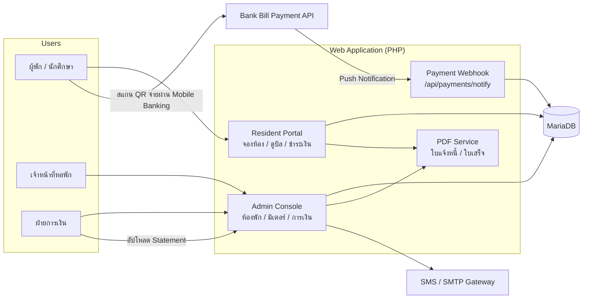
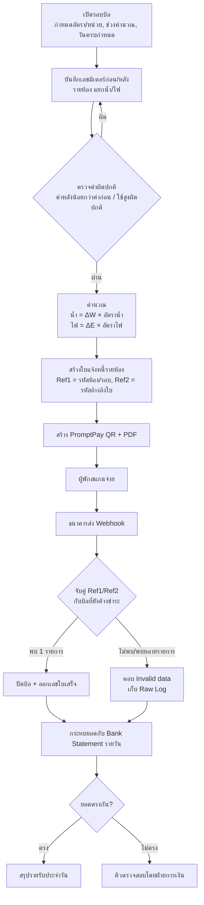
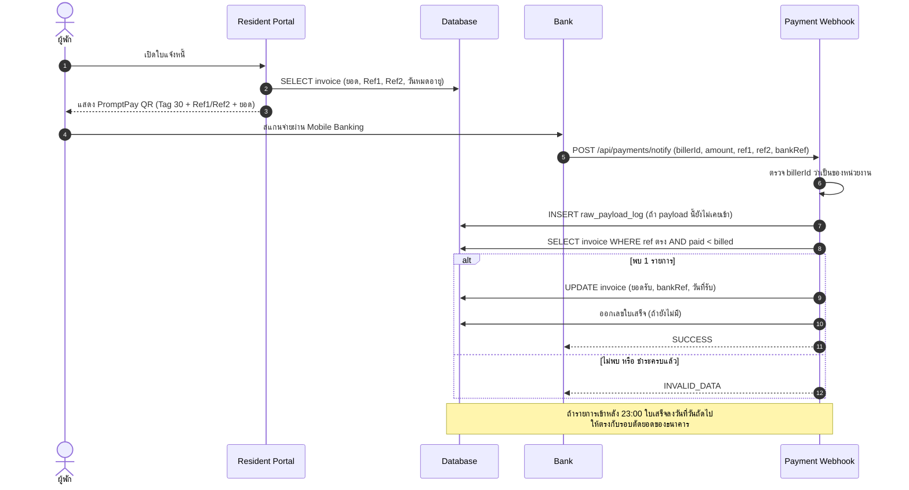
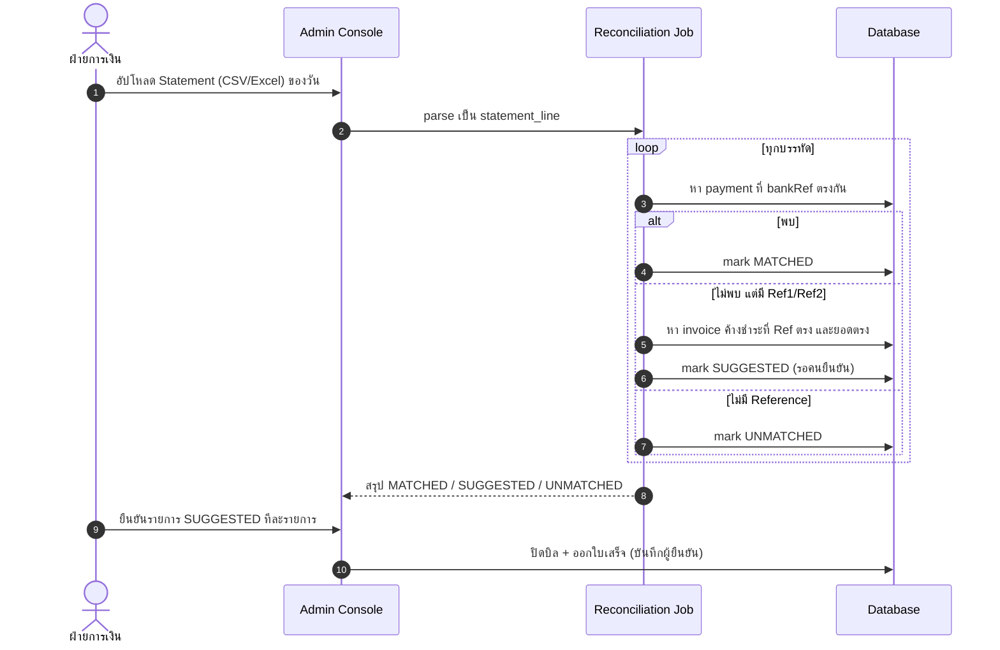
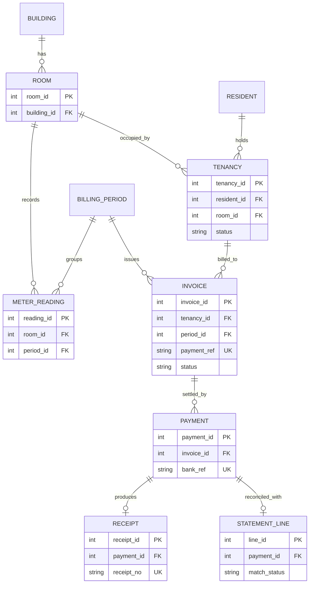

[ไทย](README.md) | [English](README.en.md)

# Dormitory & Residence Management System Architecture

> **หมายเหตุเรื่องความลับทางการค้า (NDA Notice):** เอกสารใน Repository นี้จัดทำขึ้นเพื่อแสดงแนวคิดการออกแบบสถาปัตยกรรมระบบและ Workflow สำหรับประกอบการสมัครงานเท่านั้น ซอร์สโค้ดจริง Endpoint ของระบบ Production ข้อมูลรับรอง (Credentials) รวมถึงชื่อองค์กรและลูกค้าทั้งหมดถูกตัดออกหรือแทนที่ด้วยข้อมูลสมมติเพื่อปฏิบัติตามข้อตกลงรักษาความลับ (NDA) อย่างเคร่งครัด

เอกสารวิเคราะห์ระบบและสถาปัตยกรรมของระบบบริหารจัดการหอพักนักศึกษาออนไลน์

**Tech Stack**

| ชั้น | เทคโนโลยี |
|---|---|
| Backend | PHP (Native, ไม่มี Framework), AJAX endpoint แบบ JSON |
| Database | MariaDB 10.x (InnoDB) |
| Frontend | Bootstrap 5 (Admin theme), jQuery, DataTables |
| เอกสาร | สร้างใบแจ้งหนี้/ใบเสร็จเป็น PDF ฝั่งเซิร์ฟเวอร์ |
| การชำระเงิน | Thai QR Payment (EMVCo, Bill Payment Tag 30) + Bank Bill Payment Push Notification (Webhook) |
| แจ้งเตือน | SMS Gateway (OTP / แจ้งเตือน), SMTP |
| Hosting | Linux + Nginx/Apache บน Hosting Control Panel |

---

## หน้าที่ที่รับผิดชอบ (Role: Systems Analyst & Technical Consultant)

- ดูแลและบำรุงรักษาระบบต่อเนื่อง (Preventive & Corrective Maintenance)
- เก็บ Requirement จากเจ้าหน้าที่ดูแลหอพักและฝ่ายการเงิน เพื่อออกแบบฟีเจอร์เพิ่มเติม
- ออกแบบโครงสร้างฐานข้อมูล (ERD) และ Flow การคำนวณค่าเช่า ค่าน้ำ-ค่าไฟ รวมถึงการกระทบยอดชำระเงิน (Payment Reconciliation)
- ปรับจูน Query / Database Indexing และดูแลเสถียรภาพ Session การใช้งานช่วงเปิด-ปิดเทอมที่มีผู้ใช้งานพร้อมกันจำนวนมาก
- ทดสอบระบบและตรวจสอบความถูกต้องของยอดเงินก่อนขึ้นใช้งานจริง (SIT / UAT)

---

## 1. ภาพรวมปัญหาและโซลูชัน (Problem & Solution)

ระบบดูแลหอพักนักศึกษาหลายอาคาร หลายร้อยห้อง ผู้พักหลักพันคนต่อภาคการศึกษา มีรายการเงิน 3 กลุ่มหลัก คือ ค่าหอพัก/ค่าธรรมเนียมรายเทอม, ค่าน้ำ-ค่าไฟรายรอบ, และค่าปรับ/รายการอื่น

**ปัญหาเดิม**

1. **คิดบิลน้ำ-ไฟด้วยมือ** — เจ้าหน้าที่จดเลขมิเตอร์ลงกระดาษ แล้วคำนวณใน Spreadsheet ห้องที่มีผู้พักหลายคนต้องแบ่งยอดเอง ผิดง่ายและตรวจย้อนหลังยาก
2. **ตรวจสลิปโอนเงินจำนวนมาก** — ช่วงครบกำหนดชำระมีสลิปเข้ามาหลายพันรายการ การดูสลิปทีละใบเทียบกับรายชื่อใช้เวลานาน และยอดเงินที่เท่ากันหลายคน (เช่น ค่าหอพักอัตราเดียวกันทั้งชั้น) ทำให้จับคู่ผิดคน
3. **ใบเสร็จไม่ต่อเนื่อง** — การออกเลขใบเสร็จด้วยมือทำให้เลขซ้ำ/ข้าม และวันที่ใบเสร็จไม่ตรงกับวันที่ธนาคารตัดยอด

**แนวทางของระบบ**

| ปัญหา | โซลูชัน |
|---|---|
| คิดบิลด้วยมือ | หน้าบันทึกเลขมิเตอร์รายห้อง (ก่อน/หลัง) ต่อรอบบิล ระบบคำนวณ `หน่วย × อัตรา` ตามอัตราที่ตั้งไว้ในรอบนั้น แล้วออกใบแจ้งหนี้ทั้งชั้นในครั้งเดียว |
| ตรวจสลิป | ใบแจ้งหนี้ทุกใบมี **PromptPay QR แบบ Bill Payment** ที่ฝัง Ref1/Ref2 เฉพาะใบ เมื่อจ่าย ธนาคารยิง Webhook กลับมา ระบบจับคู่ด้วย Reference ไม่ใช้ยอดเงินจับคู่ |
| ยอดที่ Webhook หลุด | กระทบยอดกับ Bank Statement รายวัน เพื่อหารายการที่เงินเข้าแล้วแต่ระบบยังไม่ปิดบิล |
| เลขใบเสร็จ | ออกเลขใบเสร็จอิเล็กทรอนิกส์อัตโนมัติ รูปแบบ `ปีงบประมาณ + ลำดับ` และกำหนด Cut-off เวลาตัดรอบของธนาคาร |

---

## 2. การไหลของข้อมูลและสถาปัตยกรรมระบบ (System Architecture & Data Flow)

### 2.1 ภาพรวมระบบ



### 2.2 Flow ค่าน้ำ-ค่าไฟ: จดมิเตอร์ → ใบแจ้งหนี้ → ชำระ → กระทบยอด



หลังเลยวันครบกำหนด ระบบเพิ่มค่าปรับเข้าไปในบิลเดิมและ **สร้าง Ref2 ใหม่** (QR เดิมใช้จ่ายไม่ได้อีก เพราะยอดเปลี่ยน) แต่เก็บ Reference ชุดแรกไว้ด้วย เพื่อให้รายการที่จ่ายด้วย QR เก่ายังจับคู่ได้

### 2.3 Sequence การชำระเงินผ่าน Webhook



### 2.4 Sequence การกระทบยอดกับ Bank Statement

ส่วนนี้ใช้กับรายการที่เงินเข้าบัญชีแล้วแต่ Webhook ไม่มาถึงหรือ Error (เช่น เซิร์ฟเวอร์ timeout ช่วงโหลดสูง) หน้างานเคยต้องกู้คืนรายการแบบนี้ทีละรายการจาก Statement จึงออกแบบเป็นขั้นตอนมาตรฐาน



หลักสำคัญ: **ระบบไม่ปิดบิลจากยอดเงินอย่างเดียว** รายการที่ไม่มี Reference ต้องให้คนยืนยันเสมอ

---

## 3. โครงสร้างฐานข้อมูลหลัก (Key Entities)

ระบบเดิมเก็บใบแจ้งหนี้กับใบเสร็จไว้ในแถวเดียวกัน และเก็บค่ามิเตอร์เป็นคอลัมน์ต่อรอบ (เพิ่มคอลัมน์ใหม่ทุกเดือน) ERD ด้านล่างเป็นโมเดลระดับแนวคิดที่ Normalize แล้ว แสดงเฉพาะ Entity หลักและคีย์ที่ใช้เชื่อมกัน ไม่ใช่ Schema จริง



| Entity | บทบาท | หลักการออกแบบ |
|---|---|---|
| `TENANCY` | สัญญาเข้าพักของผู้พักในแต่ละเทอม | ตารางเดียวพร้อมสถานะ (`BOOKED → CONFIRMED → CHECKED_IN → CHECKED_OUT`) แทนการแยกตารางตามสถานะ |
| `METER_READING` | เลขมิเตอร์ต่อห้องต่อรอบ | 1 แถวต่อห้องต่อรอบ แทนการเพิ่มคอลัมน์ทุกเดือน ค่าเริ่มของรอบนี้ต้องเท่ากับค่าสิ้นสุดของรอบก่อน |
| `INVOICE` | ใบแจ้งหนี้ (ค่าหอ / ค่าน้ำ-ไฟ / ค่าปรับ) | `payment_ref` คือ Reference ที่ฝังใน QR ใช้จับคู่การชำระ ไม่ใช้ยอดเงิน |
| `PAYMENT` | รายการรับเงินจริง | แยกจากใบแจ้งหนี้ รองรับการจ่ายหลายงวด `bank_ref` Unique กันบันทึกซ้ำ |
| `RECEIPT` | ใบเสร็จอิเล็กทรอนิกส์ | เลขใบเสร็จ Unique ออกจากตัวนับที่ล็อกใน Transaction |
| `STATEMENT_LINE` | บรรทัดจาก Bank Statement | เก็บผลการกระทบยอด `MATCHED / SUGGESTED / UNMATCHED` |

ในระบบจริงได้เพิ่ม Index ให้คอลัมน์ที่ใช้จับคู่ Reference และค้นตามผู้พัก/ห้อง/ประเภทบิล เพราะตารางบิลมีหลายหมื่นแถวและถูก query ทุกครั้งที่ Webhook เข้า ก่อนเพิ่ม Index การจับคู่แต่ละครั้งเป็น Full Table Scan

---

## 4. Core Endpoints และตัวอย่างข้อมูล (Dummy Data)

> ชื่อ Endpoint เป็นชื่อกลางที่ใช้อธิบายสถาปัตยกรรม ไม่ใช่ Route จริงของระบบ ข้อมูลทุกตัวอย่างเป็นข้อมูลสมมติ

### 4.1 Core Endpoints

| Method | Endpoint | ผู้ใช้ | หน้าที่ |
|---|---|---|---|
| `POST` | `/api/auth/login` | ผู้พัก / เจ้าหน้าที่ | ยืนยันตัวตน ออก Session ฝั่งเซิร์ฟเวอร์ |
| `POST` | `/api/bookings` | ผู้พัก | จองเตียงในรอบเปิดจอง (ตรวจและบันทึกใน Transaction เดียว) |
| `POST` | `/api/billing-periods/{id}/readings` | เจ้าหน้าที่ | บันทึกเลขมิเตอร์ของรอบบิล |
| `POST` | `/api/billing-periods/{id}/invoices` | เจ้าหน้าที่ | คำนวณและออกใบแจ้งหนี้พร้อม QR ทั้งรอบ |
| `POST` | `/api/payments/notify` | ธนาคาร | Webhook แจ้งผลการชำระเงิน |
| `POST` | `/api/reconciliations` | ฝ่ายการเงิน | อัปโหลด Statement และรันการกระทบยอด |

### 4.2 ใบแจ้งหนี้ค่าน้ำ-ค่าไฟ

```json
{
  "invoice_id": 10421,
  "type": "UTILITY",
  "period": "2026-03-R1",
  "room": "B01-0412",
  "water":    { "unit": 18,  "rate": 18.00, "amount": 324.00 },
  "electric": { "unit": 170, "rate": 5.45,  "amount": 926.50 },
  "total": 1250.50,
  "payment_ref": ["2569010412", "1503261430"],
  "due_date": "2026-03-25",
  "status": "UNPAID"
}
```

### 4.3 PromptPay QR (Bill Payment, EMVCo Tag 30)

```
000201 010212
30 67
   00 16 A000000677010112        ← AID Bill Payment
   01 15 010550000000099         ← Biller ID (สมมติ)
   02 10 2569010412              ← Ref1
   03 10 1503261430              ← Ref2
5303764                          ← THB
54071250.50                      ← ยอดเงิน
5802TH
63043BD8                         ← CRC16-CCITT
```

QR แบบ Dynamic (`010212`) ฝังยอดเงินไว้ ผู้จ่ายแก้ยอดเองไม่ได้ ลดปัญหาโอนขาด/เกิน

### 4.4 Webhook แจ้งผลการชำระเงิน

```http
POST /api/payments/notify
{
  "billerId": "010550000000099",
  "amount": "1250.50",
  "reference1": "2569010412",
  "reference2": "1503261430",
  "bankRef": "TXN20260315000001",
  "paidAt": "2026-03-15T14:32:05+07:00"
}
```

| ผลลัพธ์ | เงื่อนไข |
|---|---|
| `SUCCESS` | พบใบแจ้งหนี้ค้างชำระที่ Reference ตรง **1 รายการพอดี** และบันทึกสำเร็จ |
| `INVALID_DATA` | ไม่พบ, พบมากกว่า 1 รายการ หรือชำระครบแล้ว (กันการบันทึกซ้ำเมื่อธนาคาร retry) |
| `UNKNOWN_BILLER` | Biller ID ไม่ใช่ของหน่วยงาน |

การจับคู่ไล่จาก Reference ชุดปัจจุบันก่อน แล้วจึงลอง Reference ชุดแรก (ก่อนมีค่าปรับ) เพื่อรองรับคนที่จ่ายด้วย QR เก่า

### 4.5 ตัวอย่างการกระทบยอด Statement

| ยอด | Reference | ผล | เหตุผล |
|---:|---|---|---|
| 1,250.50 | มี | `MATCHED` | มี Payment ที่ bank_ref ตรง (Webhook เข้าปกติ) |
| 3,500.00 | มี | `SUGGESTED` | ไม่มี Payment แต่ Reference และยอดตรงกับบิลค้าง → Webhook หลุด รอคนยืนยัน |
| 3,500.00 | ไม่มี | `UNMATCHED` | โอนตรงเข้าบัญชี มีบิลยอดเท่ากันค้างอยู่หลายสิบใบ → ห้ามจับคู่อัตโนมัติ |
| 980.00 | มี | `UNMATCHED` | Reference ตรงแต่ยอดไม่ตรง (บิลมีค่าปรับแล้ว) → ส่งฝ่ายการเงินตรวจ |

---

## 5. บทเรียนจากหน้างานและแนวทางความปลอดภัย (Lessons Learned & Security)

### 5.1 ยอดโอนซ้ำ และยอดเงินตรงกันหลายคน

- **อย่าจับคู่ด้วยยอดเงิน** ค่าหอพักอัตราเดียวกันทั้งชั้น ยอดซ้ำกันหลักร้อยใบ ต้องจับด้วย Reference เท่านั้น ยอดเงินใช้เป็นเงื่อนไขตรวจซ้ำ ไม่ใช่ตัวจับคู่
- **Webhook ถูกส่งซ้ำได้** (ธนาคาร retry เมื่อไม่ได้รับคำตอบ) ระบบกันด้วย 3 ชั้น: เก็บ Raw payload ไม่ซ้ำ, เงื่อนไข `paid < billed` ในการ UPDATE, และ Unique `bank_ref` ในตาราง Payment
- **ยอดเปลี่ยนหลังออก QR** (มีค่าปรับ) ทำให้ Ref เดิมไม่ตรง เดิมรายการเหล่านี้ตกค้างและต้องปิดด้วยมือ จึงต้องเก็บ Ref ชุดแรกไว้และจับคู่ย้อนหลังได้
- **เลขใบเสร็จต้องไม่ใช้ `MAX()+1`** ถ้า Webhook 2 รายการเข้าพร้อมกัน จะได้เลขซ้ำ ต้องใช้ตารางลำดับเลข + `SELECT … FOR UPDATE` ภายใน Transaction
- **Cut-off เวลาธนาคาร** รายการหลัง 23:00 ธนาคารนับเป็นวันถัดไป วันที่ใบเสร็จต้องตามรอบนี้ ไม่อย่างนั้นยอดรายรับประจำวันไม่ตรงกับ Statement

### 5.2 โหลดช่วงวันครบกำหนดชำระและวันเปิดจองห้อง

- วันเปิดจองมีผู้ใช้เข้าพร้อมกันหลายพันคนในไม่กี่นาที อาการที่เจอคือ `504 Gateway Time-out` สาเหตุหลักคือ Query ที่ไม่มี Index และหน้ารายงานการเงินที่ดึงข้อมูลทั้งเทอมมาคำนวณใน PHP
- แก้ด้วย: เพิ่ม Index ตามคอลัมน์ที่ใช้ใน WHERE/JOIN, จำกัดช่วงข้อมูลตามเทอม, เปิด Slow Query Log ช่วงก่อนเปิดจองเพื่อหา Query ที่ต้องจูน, ตั้ง Timeout ของ PHP-FPM/Nginx ให้สอดคล้องกัน
- การจองเตียงต้องกันการจองชนกัน: ตรวจสถานะเตียงและบันทึกใน Transaction เดียว (หรือ Unique ที่ เตียง + เทอม) ไม่ใช่ตรวจแล้วค่อย INSERT แยก
- Webhook ต้องตอบเร็ว งานหนัก (สร้าง PDF, ส่ง SMS) ควรแยกออกเป็นคิว ไม่อย่างนั้นธนาคาร timeout แล้วยิงซ้ำ ซ้ำเติมโหลด

### 5.3 การคุมสิทธิ์เข้าถึงข้อมูลส่วนบุคคลและข้อมูลการเงิน

- **SQL Injection**: ใช้ Prepared Statement กับทุกค่าที่มาจากผู้ใช้ Cookie หรือ Webhook ไล่ปรับจากจุดเสี่ยงสูงสุดก่อน คือ Login, Session และ Payment Webhook ที่เปิดสาธารณะ
- **Session**: ห้ามเก็บ username/password ใน Cookie ใช้ Session ID ฝั่งเซิร์ฟเวอร์ ตั้ง `HttpOnly`, `Secure`, `SameSite` และ regenerate ID หลัง Login
- **Password**: เก็บด้วย `password_hash()` (bcrypt/argon2) และ rehash อัตโนมัติตอน Login เมื่อพบ Hash รูปแบบเก่า
- **IDOR**: ผู้พักเรียกดูบิล/ใบเสร็จได้เฉพาะของตัวเอง ตรวจ ownership ทุก endpoint ไม่เชื่อ ID ที่ส่งมาจาก Client
- **Webhook**: ตรวจ `billerId`, จำกัด IP ต้นทางของธนาคาร, Log Raw payload ทุกครั้งเพื่อใช้ตรวจย้อนหลัง
- **Secrets**: ย้าย DB password, API key, SMTP credential ออกจากโค้ดไปไว้ใน config นอก web root ที่ไม่อยู่ใน Git และหมุนรหัสเป็นระยะ
- **แยกสิทธิ์ DB User**: แอปใช้ user ที่ไม่มีสิทธิ์ DROP/CREATE, งาน backup/restore ใช้อีก user เพื่อกันการ import ทับฐานจริงโดยไม่ตั้งใจ
- **Upload folder**: ปิดการรัน script ในโฟลเดอร์อัปโหลด และตรวจ MIME type ของไฟล์
- **ไฟล์ซ่อมข้อมูลห้ามอยู่ใน web root**: การแก้ข้อมูลทำตามขั้นตอน `spec → dry-run → อนุมัติ → สร้างไฟล์ SQL ให้ผู้ดูแลรัน` และ WHERE ต้องระบุ PK กับเทอม
- **ข้อมูลทดสอบ**: งานพัฒนา/ทดสอบใช้ฐานข้อมูลที่ Mask ข้อมูลส่วนบุคคลแล้วเท่านั้น และปิดการส่ง SMS/Email จริงในสภาพแวดล้อม local/staging

### 5.4 การทดสอบก่อนขึ้นจริง (SIT / UAT)

- เทียบยอดบิลที่ระบบคำนวณกับ Spreadsheet ของฝ่ายการเงินในรอบเดียวกัน ทุกห้อง ต้องต่างกัน 0 บาท
- จำลอง Webhook ทุกกรณี: ปกติ, ส่งซ้ำ, Ref ชุดเก่า, ยอดไม่ตรง, Biller ID ผิด, รายการหลัง 23:00
- ทดสอบเลขใบเสร็จด้วย Webhook พร้อมกันหลายรายการ ตรวจว่าไม่มีเลขซ้ำ/ข้าม
- UAT กับเจ้าหน้าที่ตามรอบงานจริง: เปิดรอบบิล → จดมิเตอร์ → ออกบิล → รับชำระ → ปิดยอดรายวัน
