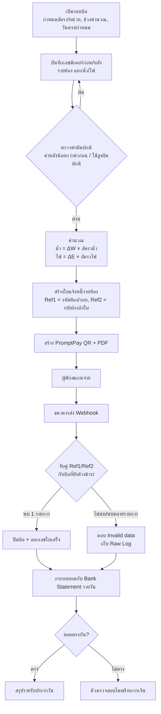
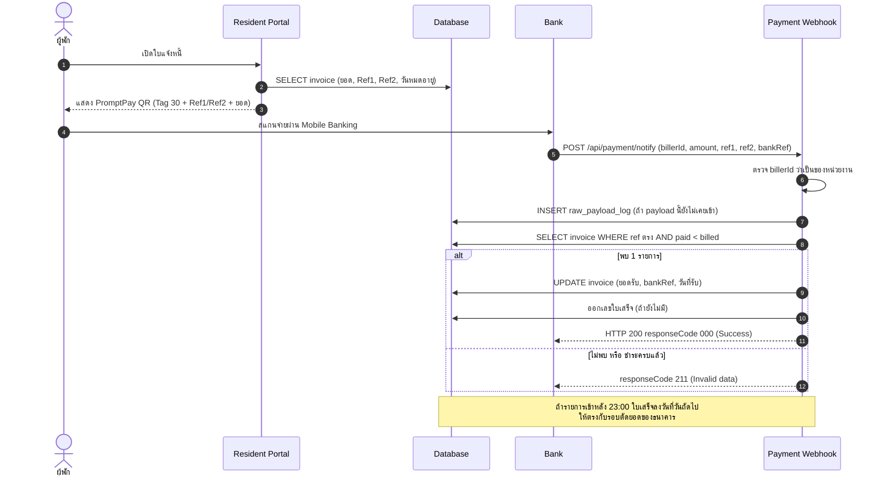
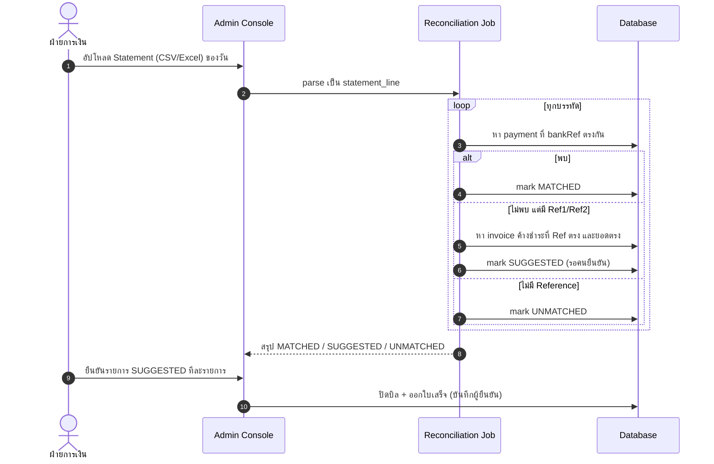
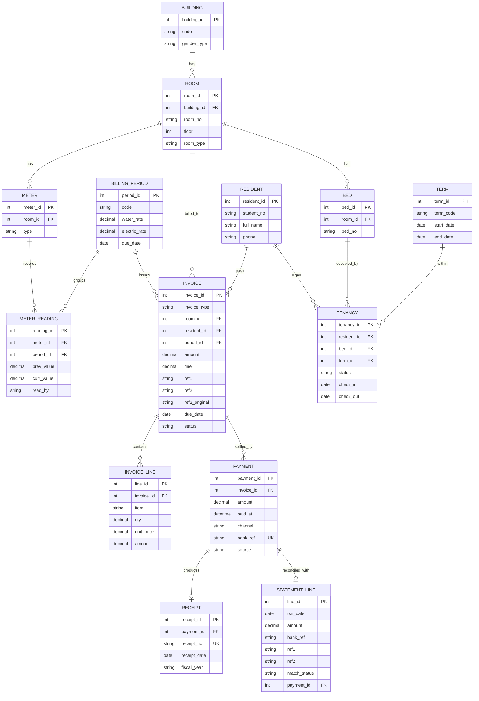

[ไทย](README.md) | [English](README.en.md)

# Dormitory & Residence Management System Architecture

เอกสารวิเคราะห์ระบบและสถาปัตยกรรมของระบบบริหารจัดการหอพักนักศึกษาออนไลน์ (ฉบับเปิดเผยได้) ชื่อตาราง ชื่อตัวแปร Endpoint และข้อมูลตัวอย่างทั้งหมดในเอกสารนี้ถูกเปลี่ยนเป็นชื่อกลางและข้อมูลสมมติ ไม่ใช่ค่าจริงของหน่วยงาน

**Tech Stack**

| ชั้น | เทคโนโลยี |
|---|---|
| Backend | PHP (Native, ไม่มี Framework), AJAX endpoint แบบ JSON |
| Database | MariaDB 10.x (InnoDB) |
| Frontend | Bootstrap 5 (Admin theme), jQuery, DataTables |
| เอกสาร | สร้างใบแจ้งหนี้/ใบเสร็จเป็น PDF ฝั่งเซิร์ฟเวอร์ |
| การชำระเงิน | Thai QR Payment (EMVCo, Bill Payment Tag 30) + Bank Bill Payment Push Notification (Webhook) |
| แจ้งเตือน | SMS Gateway (OTP / แจ้งเตือน), SMTP |
| Hosting | Linux + Nginx/Apache บน Hosting Control Panel |

---

## หน้าที่ที่รับผิดชอบ (Role: Systems Analyst & Technical Consultant)

- ดูแลและบำรุงรักษาระบบต่อเนื่อง (Preventive & Corrective Maintenance)
- เก็บ Requirement จากเจ้าหน้าที่ดูแลหอพักและฝ่ายการเงิน เพื่อออกแบบฟีเจอร์เพิ่มเติม
- ออกแบบโครงสร้างฐานข้อมูล (ERD) และ Flow การคำนวณค่าเช่า ค่าน้ำ-ค่าไฟ รวมถึงการกระทบยอดชำระเงิน (Payment Reconciliation)
- ปรับจูน Query / Database Indexing และดูแลเสถียรภาพ Session การใช้งานช่วงเปิด-ปิดเทอมที่มีผู้ใช้งานพร้อมกันจำนวนมาก
- ทดสอบระบบและตรวจสอบความถูกต้องของยอดเงินก่อนขึ้นใช้งานจริง (SIT / UAT)

---

## 1. ภาพรวมปัญหาและโซลูชัน (Problem & Solution)

ระบบดูแลหอพักนักศึกษาหลายอาคาร หลายร้อยห้อง ผู้พักหลักพันคนต่อภาคการศึกษา มีรายการเงิน 3 กลุ่มหลัก คือ ค่าหอพัก/ค่าธรรมเนียมรายเทอม, ค่าน้ำ-ค่าไฟรายรอบ, และค่าปรับ/รายการอื่น

**ปัญหาเดิม**

1. **คิดบิลน้ำ-ไฟด้วยมือ** — เจ้าหน้าที่จดเลขมิเตอร์ลงกระดาษ แล้วคำนวณใน Spreadsheet ห้องที่มีผู้พักหลายคนต้องแบ่งยอดเอง ผิดง่ายและตรวจย้อนหลังยาก
2. **ตรวจสลิปโอนเงินจำนวนมาก** — ช่วงครบกำหนดชำระมีสลิปเข้ามาหลายพันรายการ การดูสลิปทีละใบเทียบกับรายชื่อใช้เวลานาน และยอดเงินที่เท่ากันหลายคน (เช่น ค่าหอพักอัตราเดียวกันทั้งชั้น) ทำให้จับคู่ผิดคน
3. **ใบเสร็จไม่ต่อเนื่อง** — การออกเลขใบเสร็จด้วยมือทำให้เลขซ้ำ/ข้าม และวันที่ใบเสร็จไม่ตรงกับวันที่ธนาคารตัดยอด

**แนวทางของระบบ**

| ปัญหา | โซลูชัน |
|---|---|
| คิดบิลด้วยมือ | หน้าบันทึกเลขมิเตอร์รายห้อง (ก่อน/หลัง) ต่อรอบบิล ระบบคำนวณ `หน่วย × อัตรา` ตามอัตราที่ตั้งไว้ในรอบนั้น แล้วออกใบแจ้งหนี้ทั้งชั้นในครั้งเดียว |
| ตรวจสลิป | ใบแจ้งหนี้ทุกใบมี **PromptPay QR แบบ Bill Payment** ที่ฝัง Ref1/Ref2 เฉพาะใบ เมื่อจ่าย ธนาคารยิง Webhook กลับมา ระบบจับคู่ด้วย Reference ไม่ใช้ยอดเงินจับคู่ |
| ยอดที่ Webhook หลุด | กระทบยอดกับ Bank Statement รายวัน เพื่อหารายการที่เงินเข้าแล้วแต่ระบบยังไม่ปิดบิล |
| เลขใบเสร็จ | ออกเลขใบเสร็จอิเล็กทรอนิกส์อัตโนมัติ รูปแบบ `ปีงบประมาณ + ลำดับ` และกำหนด Cut-off เวลาตัดรอบของธนาคาร |

---

## 2. การไหลของข้อมูลและสถาปัตยกรรมระบบ (System Architecture & Data Flow)

### 2.1 ภาพรวมระบบ


### 2.2 Flow ค่าน้ำ-ค่าไฟ: จดมิเตอร์ → ใบแจ้งหนี้ → ชำระ → กระทบยอด



หลังเลยวันครบกำหนด ระบบเพิ่มค่าปรับเข้าไปในบิลเดิมและ **สร้าง Ref2 ใหม่** (QR เดิมใช้จ่ายไม่ได้อีก เพราะยอดเปลี่ยน) แต่เก็บ Reference ชุดแรกไว้ด้วย เพื่อให้รายการที่จ่ายด้วย QR เก่ายังจับคู่ได้

### 2.3 Sequence การชำระเงินผ่าน Webhook



### 2.4 Sequence การกระทบยอดกับ Bank Statement

ส่วนนี้ใช้กับรายการที่เงินเข้าบัญชีแล้วแต่ Webhook ไม่มาถึงหรือ Error (เช่น เซิร์ฟเวอร์ timeout ช่วงโหลดสูง) หน้างานเคยต้องกู้คืนรายการแบบนี้ทีละรายการจาก Statement จึงออกแบบเป็นขั้นตอนมาตรฐาน



หลักสำคัญ: **ระบบไม่ปิดบิลจากยอดเงินอย่างเดียว** รายการที่ไม่มี Reference ต้องให้คนยืนยันเสมอ

---

## 3. โครงสร้างฐานข้อมูลหลัก (Simplified ERD)

ระบบเดิมเก็บใบแจ้งหนี้และใบเสร็จไว้ในแถวเดียวกัน และเก็บค่ามิเตอร์เป็นคอลัมน์ต่อรอบ (เพิ่มคอลัมน์ใหม่ทุกเดือน) ERD ด้านล่างเป็นโครงสร้างที่ปรับให้เป็นมาตรฐาน (Normalize) จากการวิเคราะห์ระบบเดิม และใช้เป็นแบบสำหรับการพัฒนาต่อ



| ตาราง | คีย์สำคัญ | หมายเหตุ |
|---|---|---|
| `TENANCY` | `resident_id + term_id` | ผู้พัก 1 คนมีสัญญาได้ 1 เตียงต่อเทอม สถานะไหลตาม `BOOKED → CONFIRMED → CHECKED_IN → MOVED / CHECKED_OUT` ระบบเดิมแยกเป็นตารางต่อสถานะ ทำให้ข้อมูลซ้ำซ้อน |
| `METER_READING` | `meter_id + period_id` (Unique) | 1 แถวต่อมิเตอร์ต่อรอบ แทนการเพิ่มคอลัมน์ทุกเดือน ค่า `prev_value` ของรอบนี้ต้องเท่ากับ `curr_value` รอบก่อน |
| `INVOICE` | `ref1 + ref2` (Unique) | Reference ที่ฝังใน QR เมื่อมีค่าปรับ `ref2` เปลี่ยน แต่เก็บ `ref2_original` ไว้จับคู่การจ่ายด้วย QR เก่า |
| `PAYMENT` | `bank_ref` (Unique) | กันการบันทึกรายการโอนซ้ำจาก Webhook ที่ส่งซ้ำ (retry) แยกจาก Invoice เพื่อรองรับการจ่ายหลายงวด |
| `RECEIPT` | `receipt_no` (Unique) | ออกเลขจากตารางลำดับที่ล็อกแถว ไม่ใช้ `MAX()+1` |
| `STATEMENT_LINE` | `bank_ref`, `match_status` | ผลการกระทบยอด: `MATCHED / SUGGESTED / UNMATCHED / CONFIRMED` |

**Index ที่เพิ่มในระบบจริง** (ตารางบิลมีหลายหมื่นแถวและถูก query ทุกครั้งที่ Webhook เข้า): `member_id`, `reference_key`, `ref1`, `ref3`, `ref4`, `room`, `receipt_no`, `bill_topic`, `bill_type` — ก่อนเพิ่ม การจับคู่ Reference เป็น Full Table Scan

---

## 4. ตัวอย่าง API / Payload และโครงสร้างข้อมูล (Dummy Data)

> ข้อมูลทั้งหมดในหัวข้อนี้เป็นข้อมูลสมมติ

### 4.1 ใบแจ้งหนี้ค่าน้ำ-ค่าไฟ

```json
{
  "invoice_id": 10421,
  "invoice_type": "UTILITY",
  "period": "2026-03-R1",
  "building": "B01",
  "room_no": "B01-0412",
  "residents": ["RES-000123", "RES-000124"],
  "lines": [
    { "item": "WATER",    "prev": 1520, "curr": 1538, "unit": 18,  "rate": 18.00, "amount": 324.00 },
    { "item": "ELECTRIC", "prev": 8840, "curr": 9010, "unit": 170, "rate": 5.45,  "amount": 926.50 }
  ],
  "amount": 1250.50,
  "fine": 0.00,
  "total": 1250.50,
  "ref1": "2569010412",
  "ref2": "1503261430",
  "due_date": "2026-03-25",
  "status": "UNPAID"
}
```

### 4.2 PromptPay QR (Bill Payment, EMVCo Tag 30)

```
000201 010212
30 67
   00 16 A000000677010112        ← AID Bill Payment
   01 15 010550000000099         ← Biller ID (Tax ID 13 หลัก + Suffix 2 หลัก)
   02 10 2569010412              ← Ref1
   03 10 1503261430              ← Ref2
5303764                          ← สกุลเงิน THB
54071250.50                      ← ยอดเงิน
5802TH
63043BD8                         ← CRC16-CCITT

String จริง:
00020101021230670016A00000067701011201150105500000000990210256901041203101503261430530376454071250.505802TH63043BD8
```

QR เป็นแบบ Dynamic (`010212`) ยอดเงินฝังใน QR ผู้จ่ายแก้ยอดเองไม่ได้ ช่วยลดปัญหาโอนขาด/เกิน

### 4.3 Webhook จากธนาคาร

```http
POST /api/payment/notify
Content-Type: application/json
Request-Ref: 7f3c1e2a-0000-4000-8000-000000000001
Transmit-Date-Time: 2026-03-15T14:32:10.000+07:00
```

```json
{
  "billerId": "010550000000099",
  "transDate": "2026-03-15",
  "transTime": "14:32:05",
  "termType": "80",
  "amount": "1250.50",
  "reference1": "2569010412",
  "reference2": "1503261430",
  "fromBank": "999",
  "fromName": "MR. TEST RESIDENT",
  "bankRef": "TXN20260315000001",
  "approvalCode": "000001",
  "retryFlag": "N"
}
```

Response:

| responseCode | ความหมาย | เงื่อนไข |
|---|---|---|
| `000` | Success | พบบิลค้างชำระ 1 รายการ และบันทึกสำเร็จ |
| `211` | Invalid data | ไม่พบบิล, พบมากกว่า 1 รายการ, หรือบิลชำระครบแล้ว |
| `052` | Biller ID not registered | `billerId` ไม่ใช่ของหน่วยงาน |

ลำดับการจับคู่ (หยุดที่ชั้นแรกที่พบ **1 รายการพอดี**):

1. `ref1` + `ref2` ปัจจุบัน
2. `ref1` + `ref2` ชุดแรก (QR ก่อนมีค่าปรับ)
3. ผสมชุดแรก/ชุดปัจจุบัน
4. `ref1` + ประเภทบิลค่าสาธารณูปโภค (กรณี Ref2 ถูกสร้างใหม่หลายครั้ง)

### 4.4 ตัวอย่างการกระทบยอด Statement

| วันที่ | ยอด | bank_ref | Ref1 | Ref2 | ผล | เหตุผล |
|---|---:|---|---|---|---|---|
| 2026-03-15 | 1,250.50 | TXN…0001 | 2569010412 | 1503261430 | `MATCHED` | มี Payment ที่ bank_ref ตรง (Webhook เข้าปกติ) |
| 2026-03-15 | 3,500.00 | TXN…0002 | 2569010105 | 0103260900 | `SUGGESTED` | ไม่มี Payment แต่ Ref ตรงกับบิลค้างชำระ ยอดตรง → Webhook หลุด รอคนยืนยัน |
| 2026-03-15 | 3,500.00 | TXN…0003 | — | — | `UNMATCHED` | โอนเข้าบัญชีตรง ไม่มี Ref มีบิลยอด 3,500 ค้างอยู่ 46 ใบ → ห้ามจับคู่อัตโนมัติ |
| 2026-03-15 | 980.00 | TXN…0004 | 2569020301 | 0103260900 | `UNMATCHED` | Ref ตรงแต่ยอดไม่ตรง (บิลมีค่าปรับแล้ว ยอดใหม่ 1,080) → ส่งฝ่ายการเงินตรวจ |

---

## 5. บทเรียนจากหน้างานและแนวทางความปลอดภัย (Lessons Learned & Security)

### 5.1 ยอดโอนซ้ำ และยอดเงินตรงกันหลายคน

- **อย่าจับคู่ด้วยยอดเงิน** ค่าหอพักอัตราเดียวกันทั้งชั้น ยอดซ้ำกันหลักร้อยใบ ต้องจับด้วย Reference เท่านั้น ยอดเงินใช้เป็นเงื่อนไขตรวจซ้ำ ไม่ใช่ตัวจับคู่
- **Webhook ถูกส่งซ้ำได้** (`retryFlag`) ระบบกันด้วย 3 ชั้น: เก็บ Raw payload ไม่ซ้ำ, เงื่อนไข `paid < billed` ในการ UPDATE, และ Unique `bank_ref` ในตาราง Payment
- **ยอดเปลี่ยนหลังออก QR** (มีค่าปรับ) ทำให้ Ref เดิมไม่ตรง เดิมรายการเหล่านี้ตกค้างและต้องปิดด้วยมือ จึงต้องเก็บ Ref ชุดแรกไว้และจับคู่ย้อนหลังได้
- **เลขใบเสร็จต้องไม่ใช้ `MAX()+1`** ถ้า Webhook 2 รายการเข้าพร้อมกัน จะได้เลขซ้ำ ต้องใช้ตารางลำดับเลข + `SELECT … FOR UPDATE` ภายใน Transaction
- **Cut-off เวลาธนาคาร** รายการหลัง 23:00 ธนาคารนับเป็นวันถัดไป วันที่ใบเสร็จต้องตามรอบนี้ ไม่อย่างนั้นยอดรายรับประจำวันไม่ตรงกับ Statement

### 5.2 โหลดช่วงวันครบกำหนดชำระและวันเปิดจองห้อง

- วันเปิดจองมีผู้ใช้เข้าพร้อมกันหลายพันคนในไม่กี่นาที อาการที่เจอคือ `504 Gateway Time-out` สาเหตุหลักคือ Query ที่ไม่มี Index และหน้ารายงานการเงินที่ดึงข้อมูลทั้งเทอมมาคำนวณใน PHP
- แก้ด้วย: เพิ่ม Index ตามคอลัมน์ที่ใช้ใน WHERE/JOIN, จำกัดช่วงข้อมูลตามเทอม, เปิด Slow Query Log ช่วงก่อนเปิดจองเพื่อหา Query ที่ต้องจูน, ตั้ง Timeout ของ PHP-FPM/Nginx ให้สอดคล้องกัน
- การจองเตียงต้องกันการจองชนกัน: ตรวจสถานะเตียงและบันทึกใน Transaction เดียว (หรือใช้ Unique `bed_id + term_id`) ไม่ใช่ตรวจแล้วค่อย INSERT แยก
- Webhook ต้องตอบเร็ว งานหนัก (สร้าง PDF, ส่ง SMS) ควรแยกออกเป็นคิว ไม่อย่างนั้นธนาคาร timeout แล้วยิงซ้ำ ซ้ำเติมโหลด

### 5.3 การคุมสิทธิ์เข้าถึงข้อมูลส่วนบุคคลและข้อมูลการเงิน

- **SQL Injection**: ระบบเดิมต่อสตริงเข้า SQL ทั้งระบบ ปรับเป็น Prepared Statement ทีละกลุ่ม เริ่มจากจุดเสี่ยงสูงสุดก่อน คือ Login, Session และ Payment Webhook ที่เปิดสาธารณะ
- **Session**: ห้ามเก็บ username/password ใน Cookie ใช้ Session ID ฝั่งเซิร์ฟเวอร์ ตั้ง `HttpOnly`, `Secure`, `SameSite` และ regenerate ID หลัง Login
- **Password**: เปลี่ยนจาก MD5 เป็น `password_hash()` (bcrypt/argon2) แบบ rehash ตอน Login ครั้งถัดไป
- **IDOR**: ผู้พักเรียกดูบิล/ใบเสร็จได้เฉพาะของตัวเอง ตรวจ ownership ทุก endpoint ไม่เชื่อ ID ที่ส่งมาจาก Client
- **Webhook**: ตรวจ `billerId`, จำกัด IP ต้นทางของธนาคาร, Log Raw payload ทุกครั้งเพื่อใช้ตรวจย้อนหลัง
- **Secrets**: ย้าย DB password, API key, SMTP credential ออกจากโค้ดไปไว้ใน config นอก web root ที่ไม่อยู่ใน Git และหมุนรหัสหลังพบว่าเคยถูก commit
- **แยกสิทธิ์ DB User**: แอปใช้ user ที่ไม่มีสิทธิ์ DROP/CREATE, งาน backup/restore ใช้อีก user เพื่อกันการ import ทับฐานจริงโดยไม่ตั้งใจ
- **Upload folder**: ปิดการรัน script ในโฟลเดอร์อัปโหลด และตรวจ MIME type ของไฟล์
- **ไฟล์ซ่อมข้อมูลห้ามอยู่ใน web root**: การแก้ข้อมูลทำตามขั้นตอน `spec → dry-run → อนุมัติ → สร้างไฟล์ SQL ให้ผู้ดูแลรัน` และ WHERE ต้องระบุ PK กับเทอม
- **ข้อมูลทดสอบ**: งานพัฒนา/ทดสอบใช้ฐานข้อมูลที่ Mask ข้อมูลส่วนบุคคลแล้วเท่านั้น และปิดการส่ง SMS/Email จริงในสภาพแวดล้อม local/staging

### 5.4 การทดสอบก่อนขึ้นจริง (SIT / UAT)

- เทียบยอดบิลที่ระบบคำนวณกับ Spreadsheet ของฝ่ายการเงินในรอบเดียวกัน ทุกห้อง ต้องต่างกัน 0 บาท
- จำลอง Webhook ทุกกรณี: ปกติ, ส่งซ้ำ, Ref ชุดเก่า, ยอดไม่ตรง, Biller ID ผิด, รายการหลัง 23:00
- ทดสอบเลขใบเสร็จด้วย Webhook พร้อมกันหลายรายการ ตรวจว่าไม่มีเลขซ้ำ/ข้าม
- UAT กับเจ้าหน้าที่ตามรอบงานจริง: เปิดรอบบิล → จดมิเตอร์ → ออกบิล → รับชำระ → ปิดยอดรายวัน
